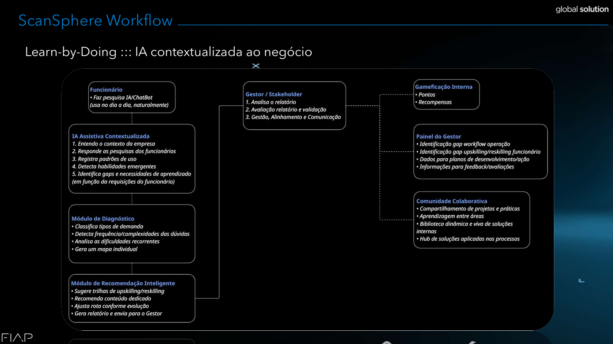
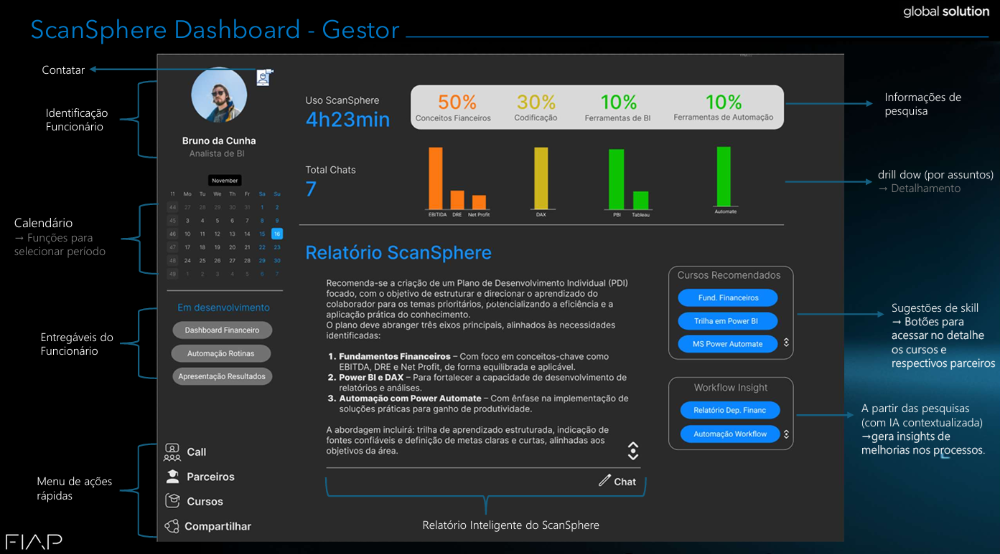
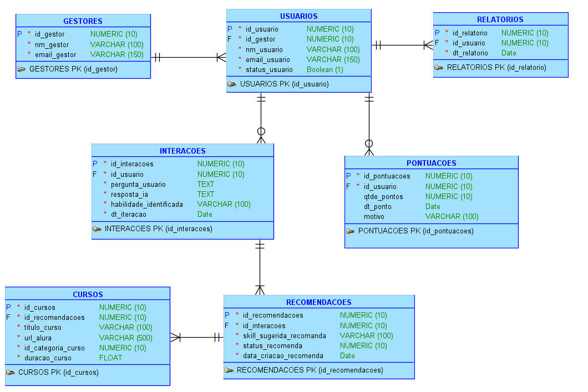
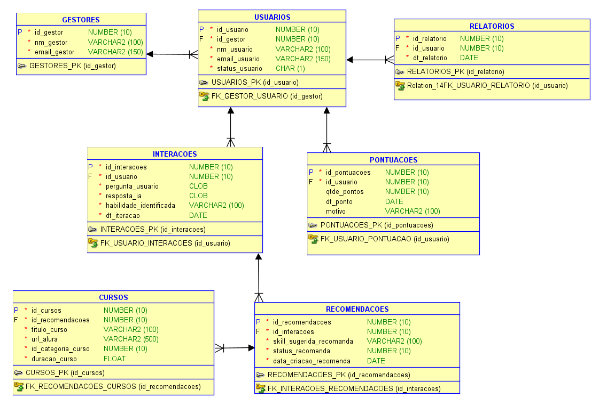

# 🌐 ScanSphere AI - O Futuro do Trabalho (FIAP Global Solution)

**Visão Executiva:** O ScanSphere é um conceito de plataforma B2B SaaS desenhada para transformar a interação diária com ferramentas de Inteligência Artificial em um ecossistema ativo de *Upskilling*, *Reskilling* e gestão de talentos corporativos (Lifelong Learning).

Desenvolvido como resposta ao desafio acadêmico **Global Solution (tema: Future at Work)** da FIAP, o projeto propõe uma transformação cultural profunda: sair do modelo reativo e genérico de treinamentos corporativos para uma abordagem contextual, preditiva e orientada por dados.

## 🎯 O Paradoxo da IA e a Dor do Negócio
A adoção acelerada de IA no ambiente corporativo criou um paradoxo: **quanto mais os colaboradores terceirizam tarefas para a máquina, menos retêm conhecimento**. 
Simultaneamente, as empresas gastam orçamentos altíssimos em plataformas tradicionais de *e-learning* (LMS) que oferecem treinamentos desconectados da realidade da operação, consumindo horas de trabalho sem atacar as deficiências reais da linha de frente. 
*   **Para a empresa (ROI):** Perda de visibilidade sobre as competências do time e desperdício financeiro em capacitações ineficazes.
*   **Para o gestor:** Falta de dados táticos para atuar como mentor, limitando sua capacidade de desenvolver a equipe estrategicamente.

## 💡 A Solução (Proposta de Valor)
O ScanSphere atua como um "escuta ativa" do fluxo de trabalho. Não é apenas um chatbot corporativo; é um motor de inteligência de negócios focado na produtividade e evolução contínua.

## 📸 Visão do Produto e Workflow

  
  

### 👤 1. Experiência do Colaborador (Learn-by-Doing)
*   **Input Contextual:** O profissional utiliza a IA corporativa para sanar dúvidas operacionais do dia a dia (ex: *como estruturar uma função DAX no Power BI*).
*   **Identificação Preditiva:** A plataforma entrega a resposta imediata, mas, em *background*, processa a lacuna de conhecimento que motivou a consulta.
*   **Micro-learning Gamificado:** O sistema sugere uma trilha rápida de qualificação focada exatamente naquele gap, atribuindo pontos (*gamificação*) pela conclusão e aplicação prática da habilidade.

### 📊 2. Visão do Gestor (Gestão Orientada a Dados)
*   **Dashboard Tático:** O gestor acessa relatórios que transformam a "fumaça" das consultas diárias em dados acionáveis, visualizando os principais gargalos técnicos do setor.
*   **Mentoria Aumentada:** Apoiado por dados reais (Health Score do time), o líder valida as trilhas sugeridas, substituindo a cultura de microgerenciamento por uma postura de patrocinador do desenvolvimento.

## ⚙️ Arquitetura e Modelagem de Dados
Para sustentar as regras de negócio e a integração sistêmica, a arquitetura foi desenhada sobre um Banco de Dados Relacional robusto, mapeando o fluxo de usuários, aprendizado e gamificação corporativa:

*   **Entidades Core:** `GESTORES`, `USUARIOS`, `INTERACOES` (captura do prompt e lacuna identificada) e `CURSOS` (catálogo de integrações com parceiros de ensino).
*   **Entidades de Negócio:** `RECOMENDACOES` (trilhas atreladas aos gaps operacionais), `RELATORIOS` (consolidação de dados para visibilidade gerencial) e `PONTUACOES` (motor da gamificação).

*(Modelagem estruturada para suportar as integrações e a gamificação)*

  
  

*(Visualize os diagramas Lógico e Relacional na pasta `/assets` deste repositório).*

## 🌍 Impacto ESG e Alinhamento Global
A arquitetura de negócio foi elaborada considerando *compliance* corporativo e aderência aos Objetivos de Desenvolvimento Sustentável (ODS) da ONU propostos pelo desafio:
*   **ODS 4 (Educação de Qualidade) e ODS 8 (Trabalho Decente):** Fomenta a qualificação contínua e a empregabilidade sem interromper o fluxo produtivo da operação.
*   **ODS 10 (Redução das Desigualdades):** Garante acesso a trilhas de requalificação personalizadas com base na necessidade operacional real do funcionário, promovendo equidade no desenvolvimento e neutralizando vieses na recomendação de treinamentos.

## 🛠️ Competências e Ferramentas Conceituais Aplicadas
*   **Engenharia de Dados:** Oracle SQL / Modelagem Entidade-Relacionamento (MER).
*   **Análise de Negócios:** Mapeamento de Workflows, Design de Dashboards Executivos, Estruturação de KPIs operacionais.
*   **Estratégia e Inovação:** Inteligência Preditiva aplicada, Micro-learning, Gamificação corporativa B2B, Customer Success Management.
